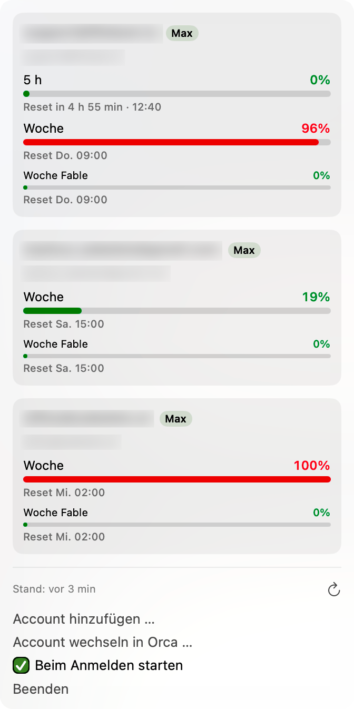
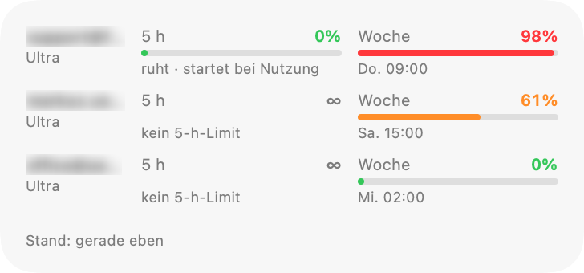
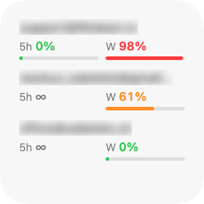
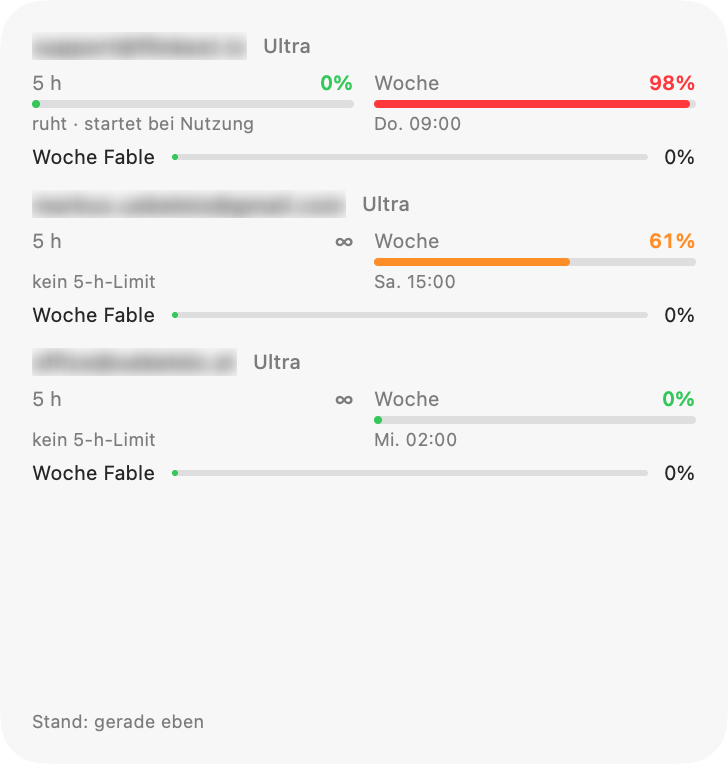

# Claude Usage

Menüleisten-App und Widget für macOS, die für **mehrere Claude-Abos (Pro/Max)** gleichzeitig anzeigt,
wie viel vom Limit verbraucht ist und **wann es zurückgesetzt wird** – 5-Stunden-Fenster, Wochenlimit
und Modell-Wochenlimits.

*A macOS menu bar app + widget that shows usage and reset times for several Claude Pro/Max accounts at once (UI in German).*

<p align="center">
  
</p>

<p align="center">
  <picture>
    <source media="(prefers-color-scheme: dark)" srcset="docs/widget-medium-dark.png">
    
  </picture>
  <picture>
    <source media="(prefers-color-scheme: dark)" srcset="docs/widget-small-dark.png">
    
  </picture>
</p>

<details>
<summary>Großes Widget</summary>
<p align="center">
  <picture>
    <source media="(prefers-color-scheme: dark)" srcset="docs/widget-large-dark.png">
    
  </picture>
</p>
</details>

## Funktionen

- Menüleiste: Kurzname + engstes Limit je Account (höherer Wert aus 5 h und Woche), z. B. `S 98 · M 61 · O 0`
- Pläne seit 30.10.2026: **Ultra** (ehem. Max 20x) hat für verifizierte Konten **kein 5-h-Limit** mehr – angezeigt als „∞ / kein 5-h-Limit“;
  solange das Konto noch nicht verifiziert ist, gilt ein vorläufiges 5-h-Limit (wird angezeigt). **Max** (ehem. Max 5x) und **Pro** behalten es.
- Pro Account: 5 h, Woche, Modell-Wochenlimits (z. B. Fable), Extra-Usage – mit Balken und Reset-Zeit
- Widget (klein / mittel / groß) für Schreibtisch und Mitteilungszentrale
- Abfrage alle 5 min und nach dem Aufwachen; respektiert Rate-Limits (`retry-after`)
- Optionaler Autostart („Beim Anmelden starten“)

## Installation

1. `ClaudeUsage.zip` aus den [Releases](../../releases) laden, entpacken, nach `/Applications` oder `~/Applications` ziehen.
2. Starten – die App ist mit Developer ID signiert und von Apple notarisiert.
3. Voraussetzung: [Claude Code](https://docs.claude.com/en/docs/claude-code) (`claude`) ist installiert – es wird nur für den Login genutzt.

## Accounts hinzufügen

Menüleiste → **Account hinzufügen …** → Name eingeben. Es öffnet sich ein Terminal mit

```sh
CLAUDE_CONFIG_DIR=~/.claude-usage/<name> claude auth login --claudeai
```

Dort im Browser mit dem gewünschten Account anmelden. Die App übernimmt den Login automatisch
(macOS fragt einmal nach Schlüsselbund-Zugriff → **Immer erlauben**). Für jeden weiteren Account wiederholen.

## Wie es funktioniert – und warum es andere Tools nicht stört

- Jeder Account bekommt einen **eigenen, separaten Login** (eigener OAuth-Grant in eigenem Konfig-Ordner).
  Die App übernimmt die Tokens in ihren eigenen Schlüsselbund-Eintrag (`ClaudeUsage`) und erneuert **nur diese**.
- Der normale Claude-Code-Login (`Claude Code-credentials`) wird **nie gelesen oder geschrieben**.
  Account-Switcher wie Orca oder dein laufendes Claude Code bleiben unberührt –
  geteilte Refresh-Tokens würden sich sonst gegenseitig ungültig machen.
- Die Daten kommen von `https://api.anthropic.com/api/oauth/usage` – derselbe Endpoint, den `/usage` in Claude Code nutzt.
  Er ist **nicht offiziell dokumentiert** und kann sich ändern; die App parst ihn deshalb tolerant.
- Das Widget selbst greift weder aufs Netz noch auf den Schlüsselbund zu; es liest nur einen Snapshot
  (ohne Secrets) aus dem App-Group-Container.

Dateien: `~/.claude-usage/accounts.json` (Namen, E-Mail, Plan), `~/.claude-usage/<name>/` (Login-Ordner),
`~/Library/Group Containers/G33B89LJ73.claudeusage/snapshot.json` (letzter Stand fürs Widget).

## Selbst bauen

Benötigt Xcode 16+ und [XcodeGen](https://github.com/yonaskolb/XcodeGen) (`brew install xcodegen`).

```sh
./scripts/build.sh     # baut, installiert nach ~/Applications und startet die App
./scripts/release.sh   # archivieren, notarisieren, ZIP unter build/release/
```

Eigenes Team: in `project.yml` `DEVELOPMENT_TEAM` und die App-Group (`<TEAMID>.claudeusage`, auch in
`Shared/Models.swift` als Fallback) anpassen.

Screenshots fürs README: `ClaudeUsage.app/Contents/MacOS/ClaudeUsage --export-screenshots docs/`
rendert die Widgets mit den aktuellen Daten, E-Mail-Adressen unscharf.

## Hinweis

Inoffizielles Projekt, nicht mit Anthropic verbunden.

## Lizenz

MIT
